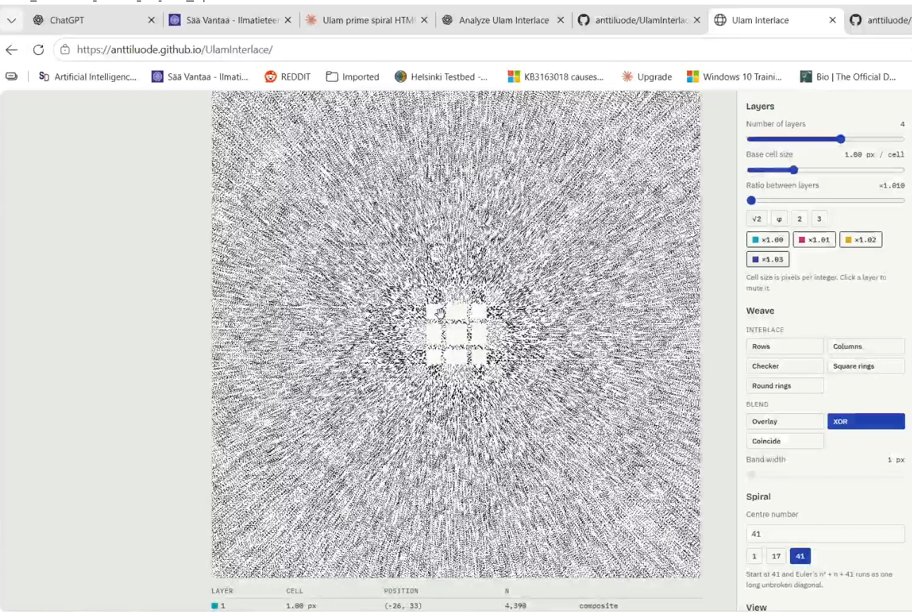
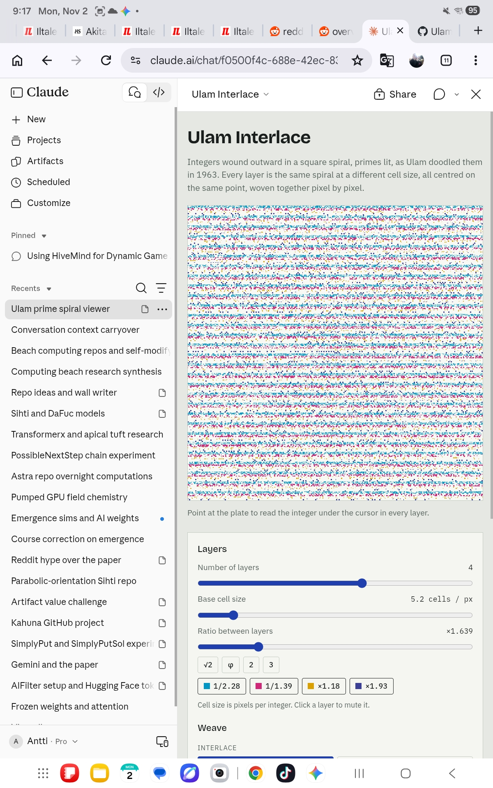
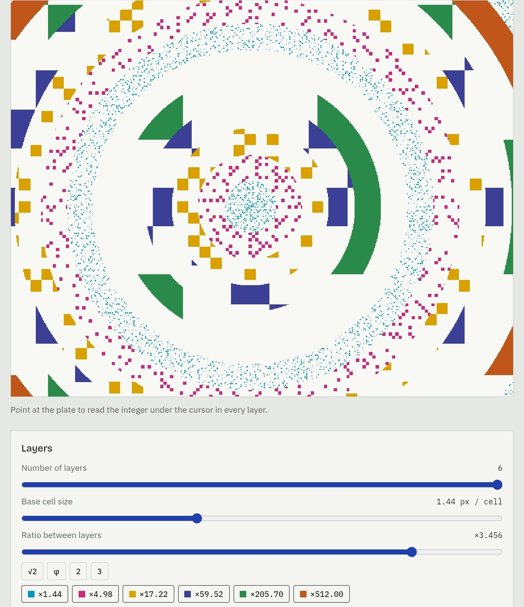
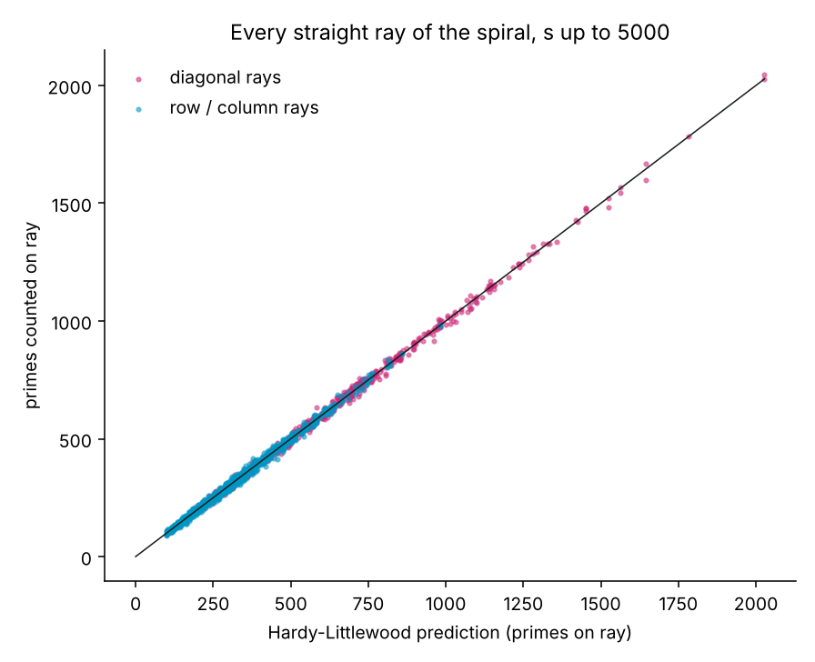
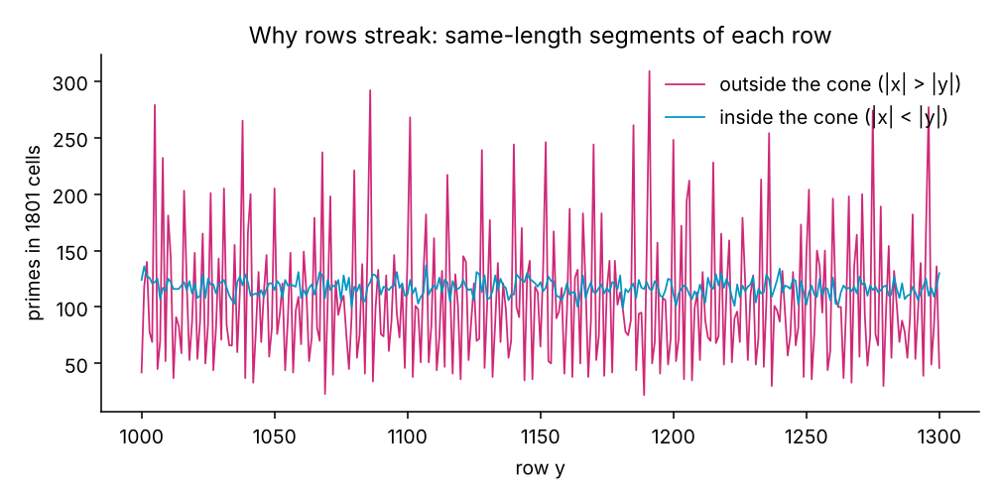
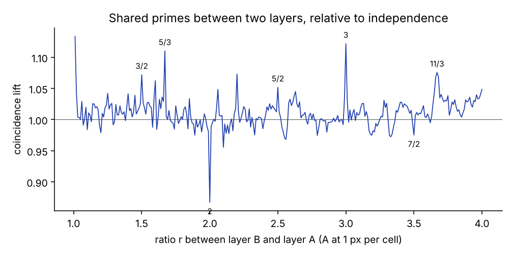

# Ulam Interlace



(Picture above is from the video at 8:36)
Video: https://www.youtube.com/watch?v=pyTtm_awohQ 


Several copies of Ulam's prime spiral, each drawn at a different zoom level, all sharing the same centre, woven together pixel by pixel.

**Try it now:** https://anttiluode.github.io/ulaminterlace/

One self-contained HTML file (`index.html`). No libraries, no build step. Open it in a browser.

| Checker, 1 px band, 6 layers, ratio ×3.79 | Square rings, 4 layers, ratio ×2.60 | Round rings, 6 layers, ratio ×3.46 |
|---|---|---|
|  |  |  |

These screenshots are taken before the layer cap was raised, so in the first one the last three layers all read ×512 (see [Reading the screenshots](#reading-the-screenshots)).

The [Analysis](#analysis) section below measures what the picture is made of: every straight line of the spiral is a quadratic polynomial, its brightness is predicted by the Hardy–Littlewood constant to within a few percent, and the horizontal streaks come from rows that are themselves quadratics.

## What it does

The Ulam spiral writes the integers outward from the centre in a square spiral (1 at the centre, 2 to the right, then counter-clockwise) and lights the primes. Primes cluster on diagonals, because each diagonal is a quadratic polynomial in the ring index.

This tool draws 1 to 6 copies of that spiral. Layer *i* has cell size

```
z_i = base · ratio^i        (pixels per integer)
```

and every layer puts the integer at the centre on the same screen point. The layers are then combined in one of eight ways.

**Interlace** (each pixel shows exactly one layer):

| Mode | Pixel belongs to layer |
|---|---|
| Rows | `floor(dy / band) mod L` |
| Columns | `floor(dx / band) mod L` |
| Checker | `floor(dx / band) + floor(dy / band) mod L` |
| Square rings | `floor(max(|dx|, |dy|) / band) mod L` — the spiral's own shells |
| Round rings | `floor(hypot(dx, dy) / band) mod L` |

`dx, dy` are measured from the shared centre, so the weave stays fixed to the spiral when you pan.

**Blend** (every layer contributes to every pixel), with each layer's value `v_i` in [0, 1]:

| Mode | Value |
|---|---|
| Overlay | dark theme: additive light, `Σ v_i · colour_i`; light theme: inks, `paper · Π (1 − v_i(1 − colour_i))` |
| XOR | `(1 − Π (1 − 2 v_i)) / 2` — for binary values, lit where an odd number of layers have a prime |
| Coincide | `Π v_i` — lit only where every layer has a prime |

The dark theme uses red, green and blue lights; the light theme uses cyan, magenta and yellow inks, so overlaps mix the way they would on a screen or on paper.

## About the horizontal lines

Three things make horizontal lines in **Rows** mode:

1. **The weave.** Each band of `band` pixel rows is taken from the next layer in turn, so the colour stripes are windows onto spirals at different scales.
2. **The rows themselves.** Outside the cone |x| < |y|, a row of the Ulam spiral is a quadratic polynomial, and different rows hold very different numbers of primes (measured: 22 to 309 primes in equal 1801-cell segments). So the bands also change brightness from row to row. See [Why rows streak](#3-why-rows-streak).
3. **Sampling.** At fractional cell sizes (say 1.18 px per integer), nearest-neighbour sampling repeats some pixel rows, which adds a fine regular beat.

## Zoomed out: density shading

Below 1 pixel per integer, one pixel covers several integers. Instead of picking one, the pixel shows

```
v = min(1, ½ · (primes in block / integers in block) · ln n)
```

The prime number theorem says primes thin out like `1 / ln n`, so multiplying by `ln n` cancels that drift and keeps the diagonals visible at large n instead of everything fading to grey.

## Other controls

- **Centre number.** The integer placed at the centre. Start at 41 and Euler's `n² + n + 41` shows up as one long unbroken diagonal of primes (it produces primes for n = 0 to 39).
- **Ratio presets.** √2, φ, 2, 3. Rational ratios line the layers' diagonals up periodically; φ and √2 do not, which gives a different moiré.
- **Layer chips.** Click to mute a layer.
- **Readout.** Hovering shows, for every layer, the cell position, the integer n there, and whether it is prime. In interlace modes the row for the layer that owns that pixel is highlighted.
- **Sweep zoom** animates the base cell size back and forth.
- Drag to pan, scroll or press `+` / `−` to zoom around the cursor, arrow keys pan.

## Limits

- Primes come from a sieve of Eratosthenes that grows as needed, capped at 2²⁵ = 33,554,432. Integers above that are not sieved and draw blank; the status line says when that happens.
- A layer's cell size is capped at 65,536 px. A layer far larger than the canvas shows only the centre cell (n = 1, not prime) and its neighbours, so it is mostly blank.
- Rendering is plain JavaScript into an `ImageData` buffer on the CPU. The canvas is at most 820 × 820 pixels. Far-zoomed-out views with many layers take longer per frame because each pixel sums over a block of integers.

## Spiral indexing

Ring *k* (Chebyshev distance *k* from the centre) holds the integers from `(2k−1)² + 1` to `(2k+1)²`. With `b = (2k−1)²`:

```
right side  x = k,  y > −k :  n = b + y + k
top         y = k         :  n = b + 2k + (k − x)
left        x = −k        :  n = b + 4k + (k − y)
bottom      y = −k        :  n = b + 6k + (x + k)
```

Then `n = index + start − 1` when the centre number is changed.

---

## Analysis

`analysis/analyze.py` reimplements the page's spiral indexing and its exact pixel-to-cell sampling in numpy, sieves to 1.2 × 10⁸, and measures the system. It runs in under 30 seconds and writes `analysis/results.json` plus the figures below. Every number in this section comes from that file.

```
python analysis/analyze.py
```

### 1. Parity law

**n ≡ x + y + 1 (mod 2)** at every cell.

The spiral is a walk on the square lattice with unit steps. Each step changes n by 1 and changes x + y by ±1, so the parities of n and x + y flip together, starting from n = 1 at (0, 0). Consequence: every odd prime sits on the cells with x + y even, one colour of a checkerboard. Checked on all 3001 × 3001 cells around the centre.

### 2. Every straight line is a quadratic, and its brightness is predictable

Far enough from the centre, every step along a diagonal, row or column crosses exactly one shell of the spiral. Shell k ends at (2k + 1)², so along any such ray

```
n(s) = 4s² + B·s + C        (exact, integer coefficients)
```

This was verified exactly for 2,408 rays (8 directions × offsets −150…150, s up to 5,000).

The parity of B decides how the ray looks:

| Ray | B | Consequence |
|---|---|---|
| diagonal (NE, SW, NW, SE) | always even | f(s) mod 2 is constant: the whole ray is odd or the whole ray is even |
| row east / west | −3 / +1 | parity alternates along the ray |
| column north / south | −1 / +3 | parity alternates along the ray |

That is why the diagonals dominate the picture. Half of all diagonals are entirely even and carry no primes at all (563 rays, 0 primes found), and the other half carry odd numbers only, at twice the average density.

**Hardy–Littlewood.** For an irreducible f, the conjectured number of primes among f(s₀), …, f(S) is

```
           S                                            1 − ω_f(p)/p
  C(f) ·   Σ   1 / ln f(s),        C(f) =   ∏ (p prime) ──────────────
          s=s₀                                           1 − 1/p
```

where ω_f(p) counts the roots of f mod p. A small prime p that never divides f(s) raises C; one that divides f often lowers it. The script computes C over primes up to 20,000 and compares with the counted primes on every ray:

| Rays | Count | Pearson r (observed vs predicted) | observed / predicted, median | 5–95 % range | C(f) range among live rays |
|---|---|---|---|---|---|
| diagonals | 1,204 | 0.999 | 1.002 | 0.95 – 1.04 | 0.62 – 6.65 |
| rows and columns | 1,204 | 0.998 | 1.001 | 0.94 – 1.07 | 0.33 – 3.27 |



C(f) is the brightness of a line. It varies more than tenfold between diagonals, which is the contrast you see between bright and faint diagonal streaks.

| Ray | f(s) | C(f) | primes counted | predicted |
|---|---|---|---|---|
| richest (line x − y = −40, NE) | 4s² − 2s + 41 | 6.65 | 2,028 | 2,027.6 |
| same line, SW ray | 4s² + 2s + 41 | 6.65 | 2,047 | 2,027.4 |
| SE ray of x + y = 58 | 4s² + 460s + 13283 | 5.93 | 1,782 | 1,782.6 |
| poorest live (x − y = −74, NE) | 4s² − 2s + 75 | 0.62 | 193 | 187.4 |

The richest line is the Euler family: 4s² ± 2s + 41 is n² + n + 41 at n = ±2s.

**Empty odd lines.** Some odd diagonals are also completely empty, because f factors. Two families on the anti-diagonal direction:

```
SE ray of x + y = −m²      (m even):  f = (2s + 1)² − m² = (2s + 1 − m)(2s + 1 + m)
NW ray of x + y = 1 + m²   (m odd):   f = 4s² − m²       = (2s − m)(2s + m)
```

m = 0 is the SE main diagonal, which is exactly the odd squares. Across all rays, 98 are reducible and they hold 0 primes.

### 3. Why rows streak

A row y = Y crosses two regions.

- **Inside the cone |x| < |y|**, the row runs along the top or bottom side of one shell, so it reads consecutive integers. Nothing arithmetic changes from one row to the next.
- **Outside the cone |x| > |y|**, the row crosses one shell per cell and reads the quadratic `4s² − 3s + (1 + Y)` (east) or `4s² + s + (1 − Y)` (west). Its density is set by C(f), which changes with Y.

Measured on rows 1000–1300, with equal 1801-cell segments of each row:

| Segment | mean primes | row-to-row sd | sd if primes were random | ratio |
|---|---|---|---|---|
| outside the cone, x = 1400…3200 | 107 | 59.3 | 10.0 | **5.9×** |
| inside the cone, x = −900…900 | 117 | 7.2 | 10.4 | 0.69× |

Outside the cone, the row counts range from 22 to 309 and correlate with the row's Hardy–Littlewood constant at r = 0.993.



So the horizontal streaks are real arithmetic, and they live in the left and right wedges of the plate. The top and bottom wedges carry the same effect turned 90°: vertical streaks from the columns.

Inside the cone the counts vary *less* than random. That is the known behaviour of primes in short intervals of consecutive integers: Montgomery and Soundararajan's formula gives a ratio of about 0.6 at these sizes. The script does not test that formula beyond this one comparison.

### 4. Square rings are one spiral with a stepped zoom

Chebyshev rings around the centre are exactly the shells of the spiral. In Square rings mode, a pixel at Chebyshev radius d that belongs to layer i shows shell k = d / zᵢ, so the integers it shows are about

```
n ≈ 4 d² / zᵢ²
```

The whole picture is therefore a single spiral whose zoom is a step function of radius.

- The four main diagonal rays pass through the shared centre. Scaling about the centre maps them to themselves, so they run unbroken across every ring boundary.
- An off-centre diagonal x − y = c sits at pixel offset c·zᵢ, so it jumps sideways by c·(zⱼ − zᵢ) where layer i meets layer j.

In the second screenshot the four layers have z = 0.294, 0.763, 1.98 and 5.14 px per cell. At d = 100 px they show integers near 464,000, 68,700, 10,200 and 1,500. The ratio between the outer two layers is 2.598⁶ ≈ 307. Each ring is a window onto a different range of the number line, at a scale where its diagonals still line up with those in the other rings.

### 5. Coincide and XOR: what links two layers

Coincide lights a pixel only where both layers have a prime. With layer A at 1 px per cell and layer B at ratio r, over 1201 × 1201 pixels:

| r | P(A prime) | P(B prime) | P(both) | lift = P(both) / (P(A) P(B)) | parity-only lift | lift from 2, 3, 5 | residual | XOR lit |
|---|---|---|---|---|---|---|---|---|
| 1.25 | 0.076 | 0.082 | 0.0066 | 1.045 | 1.00 | 1.034 | 1.010 | 14.5 % |
| √2 | 0.076 | 0.080 | 0.0062 | 1.014 | 1.00 | 1.000 | 1.015 | 14.4 % |
| 1.5 | 0.076 | 0.090 | 0.0074 | 1.069 | 1.00 | 1.060 | 1.009 | 15.2 % |
| φ | 0.076 | 0.082 | 0.0062 | 0.992 | 1.00 | 0.999 | 0.993 | 14.6 % |
| 2 | 0.076 | 0.085 | 0.0057 | **0.867** | 1.00 | 0.883 | 0.982 | 15.0 % |
| e | 0.076 | 0.090 | 0.0069 | 0.996 | 1.00 | 0.999 | 0.997 | 15.3 % |
| 3 | 0.076 | 0.092 | 0.0079 | **1.124** | 1.11 | 1.135 | 0.990 | 15.2 % |
| 4 | 0.076 | 0.097 | 0.0077 | 1.039 | 1.00 | 1.028 | 1.011 | 15.8 % |

"Lift from 2, 3, 5" is the same lift computed for "coprime to 30" instead of "prime". The residual is what is left after dividing it out.

- The two layers are close to independent. Coincide shows about the product of two prime densities, around 0.6 % of pixels.
- Every deviation larger than 1.5 % is explained by divisibility by 2, 3 and 5 alone.
- **Ratio 3 lifts by 12 %**, mostly through parity. A fine cell at x = 3X has x + y ≡ X + Y (mod 2), so both layers sit on the same checkerboard colour.
- **Ratio 2 suppresses by 13 %**. Parity is neutral here, because x = 2X makes x + y even whatever the coarse cell is. The suppression comes from residues mod 3 and 5.
- φ and e give lift ≈ 1. Their moiré is geometry, not arithmetic. This is measured on one window, not proved, and it is closeness to a simple fraction that matters rather than irrationality as such: r = 1.67, which is not exactly 5/3, still gives 1.11. Section 9 sweeps the whole range.

### 6. Shared primes on the main diagonals

For an integer ratio r, the pixel at (rm, rm) on a main diagonal shows f(rm) in the fine layer and f(m) in the coarse one. So Coincide along that diagonal asks for both f(m) and f(rm) to be prime. The two-polynomial Bateman–Horn conjecture predicts

```
   M                                       1 − ω_{fg}(p)/p
C₂ Σ  1 / (ln f(m) · ln g(m)),     C₂ = ∏ ─────────────────,    g(m) = f(rm)
  m=1                                       (1 − 1/p)²
```

Measured for m ≤ 1500:

| Diagonal | f(s) | r | both prime | predicted | C₂ |
|---|---|---|---|---|---|
| NE | 4s² − 2s + 1 | 2 | 29 | 31.8 | 3.96 |
| NE | 4s² − 2s + 1 | 3 | 43 | 49.5 | 6.59 |
| NW | 4s² + 1 | 2 | 25 | 30.6 | 3.88 |
| NW | 4s² + 1 | 3 | 32 | 28.7 | 3.88 |
| SW | 4s² + 2s + 1 | 2 | 25 | 30.9 | 3.96 |
| SW | 4s² + 2s + 1 | 3 | 46 | 48.4 | 6.59 |

In total 200 shared primes were observed against 220 predicted (0.91). That is within about 1.4 standard deviations of a Poisson count, and the conjecture is asymptotic while these values are small.

The constant differs between ratios. On the NE and SW diagonals it is 6.59 at ratio 3 and 3.96 at ratio 2, so a ratio-3 overlay shares about 1.6 times as many primes along those diagonals.

### 7. Density shading below 1 px per cell

Shaded value v = min(1, ½ · (primes / cells) · ln n), measured on the page's exact sampling footprint:

| Cell size z | Area ratio 1/z² | Cells sampled per axis | mean v across radius bins | pixels clipped at v = 1 |
|---|---|---|---|---|
| 0.5 | 4 | 3 | 0.456 – 0.480 | 14 – 22 % |
| 0.25 | 16 | 5 | 0.499 – 0.509 | 6 – 9 % |
| 0.1 | 100 | 11 | 0.511 | ≤ 0.3 % |

The ln n factor does its job. The mean stays flat while n grows from about 5 × 10⁴ to 3 × 10⁷, so the plate does not fade with distance.

Clipping is high at z = 0.5, where each pixel averages only a few cells.

A pixel samples every cell it touches, so neighbouring pixels share one edge row of cells. In effect that is a one-cell blur. The readout's "cells per px" reports the area ratio 1/z², not the sampled count.

### 8. The Euler line

With centre number 41, the line x − y = 0 through the centre carries 40 consecutive primes. These are n² + n + 41 for n = 0…39, split between the two rays. Within 60 cells of the centre, 85 % of that line is prime. The next best line has a run of 8.

### 9. Ratio sweep: where the resonances are

Lift of layer B over layer A (A at 1 px per cell, 1001 × 1001 pixels) for every ratio from 1.01 to 4.00 in steps of 0.01:



Away from fractions with denominator up to 6, the lift averages 1.010 with standard deviation 0.019, which is the noise floor of this window. The spike at r = 1.01 is trivial: the two layers are almost the same picture.

At exact fractions, the lift is split by which small primes carry it. Each column below recomputes the lift for "coprime to every prime up to p" instead of "prime":

| ratio | lift (primes) | up to 2 | up to 3 | up to 5 | up to 7 | up to 11 |
|---|---|---|---|---|---|---|
| 5/3 | **1.206** | 1.040 | 1.063 | **1.173** | 1.201 | 1.201 |
| 3 | 1.122 | **1.112** | 1.167 | 1.136 | 1.105 | 1.109 |
| 11/3 | 1.095 | 1.008 | 1.013 | 1.017 | 1.015 | **1.090** |
| 11/5 | 1.073 | 1.008 | 1.000 | 1.010 | 1.008 | **1.043** |
| 3/2 | 1.072 | 1.000 | 1.049 | 1.058 | 1.053 | 1.049 |
| 5/2 | 1.052 | 1.000 | 1.000 | 1.032 | 1.035 | 1.035 |
| 7/3 | 1.001 | 1.020 | 1.029 | 1.029 | 1.003 | 1.002 |
| 13/4 | 1.001 | 1.000 | 1.018 | 1.018 | 1.015 | 1.013 |
| 7/2 | 0.975 | 1.000 | 0.985 | 0.987 | **0.956** | 0.956 |
| 2 | **0.867** | 1.000 | **0.875** | 0.884 | 0.878 | 0.869 |

The resonances do sit at fractions p/q, but their size is not ordered by how small the denominator is. It is set by which primes divide p and q:

- 5/3 is the strongest effect in the range, larger than 3/2 or 3, and the jump happens when 5 enters.
- 11/3 and 11/5 resonate through 11 alone: the columns are flat until 11.
- 7/2 dips through 7. 7/3 and 13/4 show nothing.
- The region between the dip at 2 and the peak at 3 is not where the structure concentrates.

Why a prime dividing the numerator matters: at r = p/q, a fine cell at coordinates (p·t, p·u) and a coarse cell at (q·t, q·u) fall on the same pixel. Along a ray, n = 4s² + Bs + C, so at s = p·t the fine layer's value is ≡ C (mod ℓ) for every prime ℓ dividing p. Its divisibility by ℓ is fixed by the ray and no longer varies along it, and that couples the two layers' chances of avoiding ℓ. This is an explanation of the mechanism, not a computed prediction of the lift values.

### 10. Checker at a 1 px band: hatching, and dead slots

With Checker and a 1 px band, pixel (x, y) shows layer (dx + dy) mod L, where dx, dy are measured from the centre. Each layer therefore owns every L-th 45° line of pixels, and the weave becomes interleaved hatching with an L-pixel period (first screenshot). The hatching runs at 45°, the same direction as the prime diagonals.

That hatching meets the parity law. A layer at exactly 1 px per cell reads the cell (dx, −dy), whose x + y has the same parity as dx + dy. With an even number of layers, the slot index fixes that parity, so:

- a layer at 1 px per cell in an **even** slot sees only odd numbers;
- in an **odd** slot it sees only even numbers, so it can never show a prime except 2.

Measured with 6 layers over 1001 × 1001 pixels:

| slot | odd numbers seen | primes seen |
|---|---|---|
| 0, 2, 4 | 167,000 each | 26,099 – 26,333 |
| 1 | 0 | 1 (the number 2) |
| 3, 5 | 0 | 0 |

Slots count from 0 among the active layers, so slot 1 is the second chip. To see it on the page: 6 layers, Checker, 1 px band, ratio 2, and base cell size 0.5 (4.0 cells / px). The second layer then sits at exactly 1 px per cell, and its hatch lines go blank apart from the single cell holding 2. Set an odd number of layers and the effect vanishes, because an odd L no longer fixes the parity of a slot.

### 11. Exact parity resonance for rational scale ratios

The spike at ratio 3 is not merely a visual moire. For the **binary, one-pixel-per-cell** coincidence experiment (centre number 1), the parity contribution can be calculated exactly.

Let the ratio of coarse to fine cell size be a reduced rational number $r=P/Q$, with positive coprime integers $P,Q$. With the fine layer at 1 px/cell, the coarse layer reads

$
T_r(x)=\left\lfloor\frac{Qx}{P}+\frac12\right\rfloor.
$

The spiral indexing obeys $U(x,y)\equiv x+y+1\pmod 2$. Counting two-dimensional parity matches over their complete repeating residue pattern gives the **exact large-window odd-position lift**

$
\boxed{
L_2(P/Q)=
\begin{cases}
1+1/P^2,&P,Q\text{ both odd},\\
1,&\text{otherwise}.
\end{cases}}
$

This is a statement about odd-number positions, **not** about simultaneous primes. The $1/P^2$ comes from the two independent spatial coordinates: the one-dimensional parity correlation has magnitude $1/P$, which is squared in the two-dimensional count.

| Ratio | Exact parity lift | Finite-window parity lift measured in section 9 |
|---|---:|---:|
| 3 | 1.11111 | 1.112 |
| 5/3 | 1.04000 | 1.040 |
| 7/3 | 1.02041 | 1.020 |
| 11/3 | 1.00826 | 1.008 |
| 2 | 1.00000 | 1.000 |
| 3/2 | 1.00000 | 1.000 |

The exact law was separately checked by enumerating the full $2P$-period coordinate pattern. It explains a component of the prime-coincidence peaks without ever calling a primality test. Note that the numbers in the original ratio sweep are **prime** lifts, and need not equal these parity lifts.

### 12. A directional surprise: rational resonance is anisotropic

The spiral has a winding direction. The four cardinal wedges (away from their diagonal boundaries) have different exact indexing polynomials, with the usual mathematical coordinates $y$ pointing upward:

$
\begin{aligned}
E:\quad U(x,y)&=4x^2-3x+y+1,\\
W:\quad U(x,y)&=4x^2-x-y+1,\\
N:\quad U(x,y)&=4y^2-y-x+1,\\
S:\quad U(x,y)&=4y^2-3y+x+1.
\end{aligned}
$

The E and S wedges share an algebraic pattern, as do W and N. This suggests examining coincidence by wedge instead of averaging over the entire plate.

The following were recomputed independently with the repository's spiral formula, nearest-neighbour sampling $\lfloor x/r+1/2\rfloor$, exact primality and centre number 1, over $[-500,500]^2$. Each entry is $P(A\land B)/[P(A)P(B)]$ **within that wedge**; E means $x>|y|$, W means $-x>|y|$, N means $y>|x|$, and S means $-y>|x|$.

| Scale | E wedge | W wedge | N wedge | S wedge | Whole square |
|---|---:|---:|---:|---:|---:|
| 5/3 | **1.385** | 1.029 | 1.055 | **1.374** | 1.206 |
| 3 | **0.934** | **1.301** | **1.285** | 0.953 | 1.122 |
| 2 | 0.877 | 0.856 | 0.871 | 0.855 | 0.867 |

At 5/3, the enhancements on E and S are much stronger than the global average. At 3, E/S are slightly suppressed while W/N are strongly enhanced. The global lift hides this directional structure.

These are **finite-window measurements**, not proved asymptotic constants. Their asymmetry is compatible with the different wedge polynomials and their small-divisor residues. This is more discriminating than comparing only one global coincidence number.

### 13. Arithmetic offset acts like a phase control

Keeping the geometry fixed and changing only the **centre number** shifts every spiral integer by a constant, altering its residues modulo small primes. This can reverse a scale resonance.

Independently recomputed whole-square lifts on the same $1001\times1001$ pixel window:

| Centre number | Ratio 5/3 | Ratio 3 | Ratio 2 |
|---|---:|---:|---:|
| 1 | 1.206 | 1.122 | 0.867 |
| 2 | 1.135 | 1.326 | 1.001 |
| 3 | 0.909 | 0.829 | 1.129 |
| 4 | **0.803** | 1.151 | 1.056 |
| 41 | 1.122 | 1.328 | 0.993 |

At 5/3, moving from centre 1 to centre 4 changes a 20.6% enhancement into a 19.7% suppression, without changing the spatial weave. This is strong evidence for **arithmetic congruence selection**, not simply optical interference. The offset is an *arithmetic phase* (modular translation), not an optical or complex-valued phase.

### 14. Predicting scale resonances with a finite modular sieve

The strongest next step is to predict coincidence from *local divisibility* instead of prime tests.

For a reduced ratio $P/Q$, write each fine coordinate as $x=Pa+u$, $0\leq u<P$. Then

$
T_r(x)=Qa+\left\lfloor\frac{Qu}{P}+\frac12\right\rfloor.
$

The same holds independently for $y=Pb+v$. Fix residues $u,v$, a cardinal wedge and an offset $c$. For each small prime $\ell$, enumerate $a,b\pmod\ell$ and count the cases where neither the fine nor coarse wedge polynomial plus $c-1$ is divisible by $\ell$.

By the Chinese remainder theorem, those per-prime probabilities multiply **conditional on the shared residues $u,v$**. Average over $u,v$ and the four wedges to obtain the large-region lift of a finite-sieve surrogate (numbers coprime to $2\cdot3\cdot5\cdot7\cdot11=2310$). This is an exact finite-residue calculation for that surrogate, not an exact prime-number theorem.

Independent computations with this five-prime model:

| Ratio | Modular-model lift | Actual prime lift (1001² window) |
|---|---:|---:|
| 5/3 | **1.199** | **1.206** |
| 3 | 1.108 | 1.122 |
| 2 | 0.869 | 0.867 |
| 3/2 | 1.050 | 1.072 |
| 11/3 | 1.089 | 1.095 |
| 7/3 | 1.002 | 1.001 |

The model even reproduces the centre-number reversal at ratio 5/3: it predicts **1.199** with centre 1 and **0.799** with centre 4, against actual prime lifts of **1.206** and **0.803**.

The model uses an asymptotic, equally weighted four-wedge density, while the prime counts above use finite square windows. Their agreement is strong evidence for the proposed *small-divisor mechanism*, but the residuals mix higher-prime effects with finite-size and boundary effects. A precise residual study must compare **matched-window** baselines.

### 15. Resonance width and finite observation scale

Exact and nearly rational ratios behave differently as the spatial window expands. A small change $\delta r$ changes the coarse sampled coordinate at large $|x|$ by roughly

$
|\Delta T_r(x)|\simeq \frac{|x|}{r^2}|\delta r|.
$

Thus the alignment scale should narrow roughly like $r^2/R$ for window radius $R$. This is a **geometric coherence estimate**, not a theorem for the precise width of the prime-lift peak.

Measured whole-square prime lifts, centre number 1:

| Half-width $R$ | Exact 5/3 | Decimal 1.67 |
|---|---:|---:|
| 100 px | 1.224 | 1.197 |
| 500 px | 1.206 | 1.110 |
| 800 px | 1.207 | 1.054 |

The exact rational alignment remains; the nearby decimal loses lift as the observation area grows. The page's ratio slider has step 0.001 and **cannot set 5/3 exactly**, so a numerator/denominator input is needed for serious high-resolution ratio scans.

### 16. Quadratic characters, Euler's line, and -163

The bright ray $4s^2-2s+41$ is a subsequence of Euler's polynomial $n^2-n+41$, taking $n=2s$. The full Euler polynomial has discriminant $-163$; the ray polynomial's discriminant is $-652=4(-163)$.

For an odd prime $\ell$ not dividing the leading coefficient, the number of polynomial roots modulo $\ell$ is

$
\omega_f(\ell)=1+\left(\frac{\Delta}{\ell}\right),
$

where the parenthesized term is the Legendre symbol. Consequently, the odd-prime Bateman-Horn factor is $1-\chi_\Delta(\ell)/(\ell-1)$. The brightness of a quadratic ray is tied to quadratic residue characters and, more deeply, Dirichlet $L$-functions.

The appearance of $-163$ connects Euler's classic prime-rich polynomial with the imaginary quadratic field $\mathbb Q(\sqrt{-163})$, whose ring of integers has class number one. This is a **known classical connection**, not a new claim about the Riemann hypothesis or an explanation of all interlace resonances.

For background on the polynomial local factors, see [Bateman-Horn at the Encyclopedia of Mathematics](https://encyclopediaofmath.org/wiki/Bateman-Horn_conjecture) and [the AMS exposition](https://doi.org/10.1090/noti3046). For the Euler/Heegner-number connection, see [this discussion of the Ulam spiral and discriminant -163](https://www.mdpi.com/2673-9321/6/2/22).

### 17. What would count as a new result?

The natural research object is a **scale-and-offset correlation surface**. Let $U(x,y)$ be spiral indexing and $\mathbf 1_{\mathbb P}$ the prime indicator. For each finite observation window $W$, examine

$
C_W(r,c)=\operatorname{Corr}_{(x,y)\in W}
\left[\mathbf 1_{\mathbb P}(U(x,y)+c),
\mathbf 1_{\mathbb P}\big(U(T_r(x),T_r(y))+c\big)\right].
$

Here $c=\text{centre number}-1$, and the correlation coefficient is distinct from the *lift* reported in the tables above.

Research plan:

1. Add exact rational $P/Q$ controls; render the full correlation surface over ratio, offset and quadrant.
2. Compare prime lifts with finite-sieve baselines for primes up to 2, 3, 5, 7, 11 and beyond, **using the same sampling window and centre number**.
3. Inspect the residual after the modular prediction, across several radii and held-out offsets, with shuffled and residue-preserving controls.
4. Separate integer-cell Coincide from subpixel-density blending; when $z<1$, multiplication of grey density values is **not** the binary event "both sampled integers prime".
5. Test predictions on new ratios and larger numerical ranges, preferably with segmented sieving instead of silently extending beyond the HTML sieve cap.

A surviving, reproducible residual would be interesting; its significance would need statistical controls and comparison with existing sieve and Bateman-Horn theory. The current work establishes **exact geometric/parity identities and finite numerical modular resonances**, not a new prime-number theorem.

### Reading the screenshots

- **Round rings (third screenshot).** The coarse layers are 59.5, 205.7 and 512 px per cell, so a single cell is about as wide as a ring band or wider. Those layers show only the first handful of integers. Their lit cells are the small primes 2, 3, 5, 7, 11, …, cut into arcs and triangles by the circular mask.
- **Staircases.** In the middle layers, primes appear as blocks that touch only at corners and chain diagonally. That is the parity law made visible: primes sit only on cells with x + y even, and two such cells can only meet at a corner.
- **The ×512 triplet (first screenshot).** At base 10.76 and ratio 3.789, layers 4–6 would be 585, 2,217 and 8,400 px per cell. They were all clamped to the old cap of 512 and drew the same spiral, so three of every six hatch lines showed the same cell. That is why the dark hatched regions look so dense. The cap is now 65,536, so those layers keep scaling (and become mostly blank, since they show only the cells next to the centre).

### Ledger

**Verified exactly**
- the parity law, and the dead odd slots of the 1 px Checker weave that follow from it
- the rational-ratio parity lift law in section 11 (for the specified nearest-neighbour sampling, in the full-period limit)
- that every ray beyond the central cross is an exact quadratic
- that reducible and even rays hold no primes in range

**Measured, within the computed range**
- Hardy–Littlewood and Bateman–Horn agreement (both are conjectures; these are consistency checks, not proofs)
- the row-streak variance
- the layer lifts and the ratio sweep
- the directional and centre-offset lifts, modular-surrogate comparison, and finite-window resonance narrowing (sections 12-15)
- the shading calibration

**Not established here**
- the Montgomery–Soundararajan comparison, beyond one number
- an exact prediction for the **prime** resonance sizes; section 14 gives an exact prediction for a finite modular-sieve surrogate, not for primes
- anything new in number theory: the arithmetic of Ulam diagonals is classical (Hardy & Littlewood 1923, Bateman & Horn 1962)

What is specific to this tool is how its weaves select from that arithmetic:
- rows sample the quadratic rows of the spiral
- square rings stack shells from different integer ranges
- Coincide at integer ratios pairs f(m) with f(rm)
